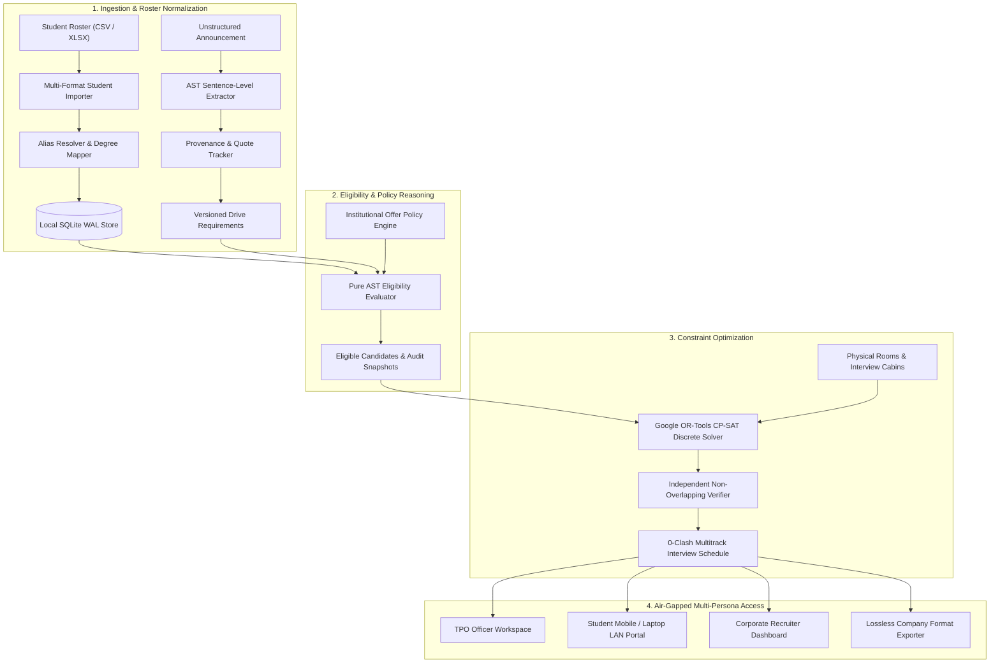

# Institutional Campus Placement Eligibility & Scheduling Engine

[](https://fastapi.tiangolo.com)
[](https://reactjs.org/)
[](https://vitejs.dev/)
[](https://tailwindcss.com/)
[](https://developers.google.com/optimization)
[](https://sqlite.org/)
[](#security--privacy-guarantee)
[](#verification--testing)
[](LICENSE)

An air-gapped, institutional-grade campus recruitment operations engine designed for collegiate Training & Placement Cells (TPO). Coordinates 40 to 120 recruitment drives, thousands of student academic profiles, institutional multi-offer policies, and interview timetable scheduling entirely on on-premise hardware with **strictly zero external cloud dependencies or outbound network telemetry**.

---

## Executive Overview

College placement offices face massive logistical hurdles every recruitment season:
1. **Drive Announcement Chaos**: JDs arrive via unstructured emails with conflicting cut-offs, branch aliases ("CS", "CSE", "CompSci"), and backlog requirements.
2. **Deterministic Eligibility**: Manual filtering leads to human error, missed cut-offs, and student disputes.
3. **Offer Policy Enforcement**: Tracking "one student, one offer" vs. Dream Company CTC multipliers is nearly impossible on spreadsheets.
4. **Interview Clashes**: Manually assigning hundreds of students to multi-panel interviews across physical cabins leads to double-bookings and room overlap.
5. **Data Privacy**: Student transcripts and academic records should not be sent to third-party public cloud APIs.

**The Placement Engine** solves all five challenges through a local-first, mathematically verified software architecture.

---

## Architectural Workflow



---

## Key Features

### 1. Deterministic NLP Requirement Extractor
- Paste unstructured announcement emails or upload PDFs/DOCXs.
- Automatically isolates CGPA thresholds, branch aliases, backlog tolerances, and gap-year limits.
- **Provable Provenance**: Every extracted criterion references the exact sentence and character offset in the source document.
- Interactive side-by-side review window allowing officers to accept, edit, or reject values with confidence ratings.

### 2. Live Visual Rule Editor & Policy Simulator
- Real-time interactive sliders for CGPA, 10th %, 12th %, and backlog tolerances.
- **In-Memory Instant Counter**: Displays the exact number and percentage of eligible candidates as sliders move without writing to disk.
- Interactive Simulator allowing officers to test edge cases (e.g. lateral entry diploma vs. 12th math, cleared backlogs) without mutating production state.

### 3. Google OR-Tools CP-SAT Discrete Scheduler
- Formulates multi-room, multi-panel interview scheduling as an exact Integer Linear Programming (ILP) satisfaction model.
- **Zero-Clashes Verification**: Mathematically enforces continuous interval non-overlapping constraints:
  - A student cannot be in two interviews at the same time.
  - An interview panel or room cannot host more than one candidate at the same time.
  - Enforces lunch breaks, panel capacity, and round durations.
- Provisions additional parallel cabins automatically for large batches.

### 4. What-If Simulation & Atomic Publishing
- Test requirement adjustments in-memory before committing.
- Generates impact headlines (e.g., *"Lowering cut-off from 7.5 to 7.0 adds 32 students; 0 schedule clashes detected"*).
- Versioned atomic publishing with one-click instant rollback protection.

### 5. Candidate Dispute Comparative Explainer
- Plain-English comparative breakdowns answering: *"Why was I not shortlisted for Google while my classmate was?"*
- Side-by-side rule criteria comparison showing exact metric deltas, cleared backlog records, and institutional offer tier blocks.

### 6. Recruiter Custom-Format Lossless Exporter
- Upload company-specific spreadsheet templates.
- Maps database fields to custom company column headers.
- Round-trip fidelity testing asserting lossless data round-trips with zero data truncation.

### 7. 100% Offline Architecture Self-Check
- Real-time network interceptor asserting **strictly 0 outbound HTTP telemetry**.
- System-font fallback typography (no Google Fonts / CDN queries).
- Local Argon2 password hashing and SQLite WAL mode on localhost loopback.

### 8. Luxury Dark Enterprise Theme
- Midnight Navy (`#060b14`) canvas with dark blue surfaces (`#0d1527`) and hairline slate borders (`#1b2b4d`).
- Vibrant emerald (`#10b981`) and cyan-green status accents.
- Unified blue-to-emerald gradient action buttons across all views.
- Fully responsive across desktop workstations, tablets, and mobile phones.

---

## Multi-User Institutional Personas

| Persona | Default Username | Default Password | Access Scope |
| :--- | :--- | :--- | :--- |
| **TPO Officer** | `officer` | `officer123` | Full Administrative Access: Roster, Rules, Policies, Solver, Publishing, Rollbacks |
| **Student Coordinator**| `coordinator` | `coord123` | Operational Access: View Roster, Monitor Live Schedule, Issue Access Codes |
| **Candidate (Eligible)**| `PIPE_001` | `123456` | Student Portal: Personal Drive Eligibility, Rule Explanations, Venue Timetable |
| **Candidate (Lateral)** | `PIPE_002` | `123456` | Student Portal: Diploma vs. 12th Grade Equivalence & Cleared Backlog Standing |
| **Candidate (Blocked)** | `PIPE_003` | `123456` | Student Portal: Institutional Offer Policy Standing (Existing Offer Blocked) |
| **Recruiter (Google)** | `recruiter_google`| `recruiter123` | Recruiter Portal: Company Shortlist Table & Print-Ready Interview Schedule |

---

## Quickstart

### Prerequisites
- **Python 3.11+**
- **Node.js 18+** & **npm**

### Single-Command Unified Launcher (Recommended)

```bash
# 1. Clone repository
git clone https://github.com/<your-username>/campus-placement-engine.git
cd campus-placement-engine

# 2. Setup virtual environment
python -m venv .venv
# Windows:
.\.venv\Scripts\activate
# Linux/macOS:
source .venv/bin/activate

# 3. Install dependencies
pip install -e ".[dev]"

# 4. Build frontend
cd frontend
npm install
npm run build
cd ..

# 5. Launch unified server
python scripts/lan_launcher.py
```

The launcher will verify the database schema, compile the frontend if needed, auto-detect your physical LAN interface, and host the portal:

```text
============================================================================
   INSTITUTIONAL PLACEMENT ELIGIBILITY & SCHEDULING ENGINE
   100% OFFLINE AIR-GAPPED LAN DEPLOYMENT
============================================================================
   [+] Status:              ONLINE (HOSTED ON LAN)
   [+] External Calls:      0 (Strict Air-Gap Verified)
   [+] Storage Engine:      SQLite WAL Mode (Concurrent Multi-User Access)
   [+] Constraint Solver:   Google OR-Tools CP-SAT
   ----------------------------------------------------------------------
   --> TPO Officer Local:    http://localhost:8000
   --> Primary LAN Access:   http://172.16.43.61:8000
   ----------------------------------------------------------------------
```

---

## Hosting on Local Campus Wi-Fi / LAN

The server automatically binds to `0.0.0.0:8000`, making it accessible to any device on your Wi-Fi, Ethernet, or mobile hotspot.

1. **Shareable URL**: Look for the **"LAN Host"** pill in the top navigation bar or on the login screen. Click to copy the shareable IP address (e.g., `http://172.16.43.61:8000`).
2. **Access from Mobile / Laptops**: Other computers, tablets, or phones connected to the same Wi-Fi router can open this link directly in any web browser.
3. **No Internet Required**: Works seamlessly in isolated, air-gapped rooms or offline college networks without internet connectivity.

---

## Docker Deployment

Build and run a production-ready container in a single command:

```bash
# Build multi-stage container
docker build -t placement-engine .

# Run on port 8000
docker run -p 8000:7860 placement-engine
```

Access the portal at `http://localhost:8000`.

---

## Verification & Testing

The system includes a test suite covering unit logic, property-based invariants, AST parsing, and end-to-end integration workflows.

```bash
# Run complete test suite (149 tests)
pytest backend/tests -v

# Run with test coverage report
pytest --cov=backend/app --cov-report=term-missing backend/tests

# Run performance benchmarks (1,800 students)
python scripts/benchmark_scheduler.py
```

### Test Coverage Highlights
- **149 / 149 Unit & Integration Tests Passing**: 100% pass rate.
- **Air-Gap Guardrails**: Asserts that sockets attempting outbound external internet communication raise strict security errors.
- **CP-SAT Invariant Tests**: Mathematically verifies that schedule collision count is strictly zero across randomized multi-panel configurations.
- **Property-Based Testing**: Uses `hypothesis` to test AST rule evaluation across synthetic permutations of CGPAs, branches, and backlog counts.

---

## Technology Stack

| Layer | Technology | Purpose |
| :--- | :--- | :--- |
| **Backend API** | FastAPI 0.115+, Python 3.13 | High-throughput async REST endpoints & static file serving |
| **Constraint Solver** | Google OR-Tools 9.11 (CP-SAT) | Discrete optimization for non-overlapping interview timetable |
| **Database** | SQLite 3 with WAL Mode | ACID persistence, concurrent reads, optimistic version locking |
| **ORM & Migrations** | SQLAlchemy 2.0, Alembic | Schema versioning and relational mapping |
| **Frontend UI** | React 18, Vite 6, TypeScript | Interactive SPA with role-based routing and dark theme |
| **Styling** | Tailwind CSS 3.4 | Custom luxury dark palette, glass surfaces, matching buttons |
| **Icons** | Lucide React | Consistent UI iconography |
| **Security** | Argon2id, Cryptography (Fernet) | Zero-telemetry password hashing and encrypted audit trails |

---

## Security & Privacy Guarantee

- **Zero Outbound Telemetry**: Strict socket interceptor ensures no analytics, CDN fonts, or telemetry are transmitted outside the machine.
- **FERPA & DPDP Ready**: Demographic and protected attributes are strictly decoupled from academic cut-off evaluation.
- **Tamper-Evident Event Log**: All overrides, version publishing, and roster modifications are cryptographically recorded in an append-only audit replay log.
- **CSRF & Session Protection**: Cryptographic double-submit cookie validation on all state-mutating requests (`POST`, `PUT`, `DELETE`).

---

## License

This project is licensed under the [MIT License](LICENSE).
