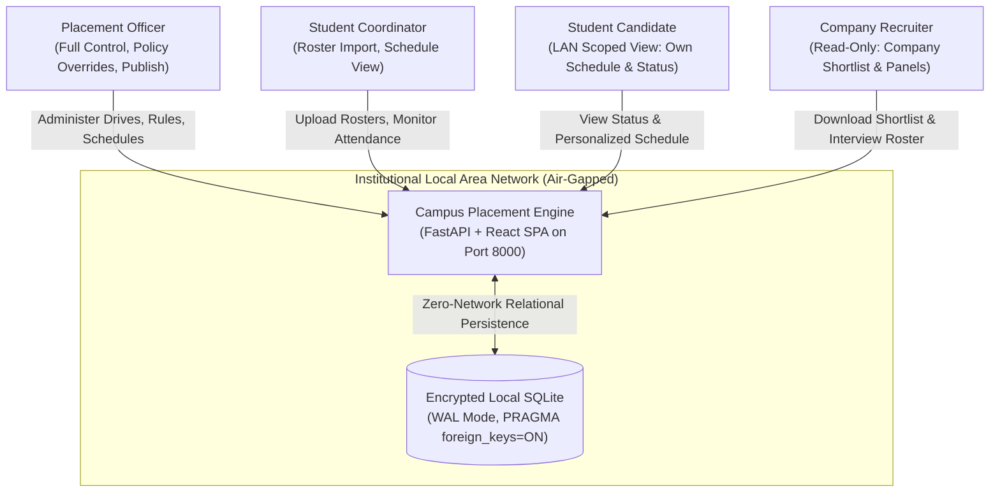
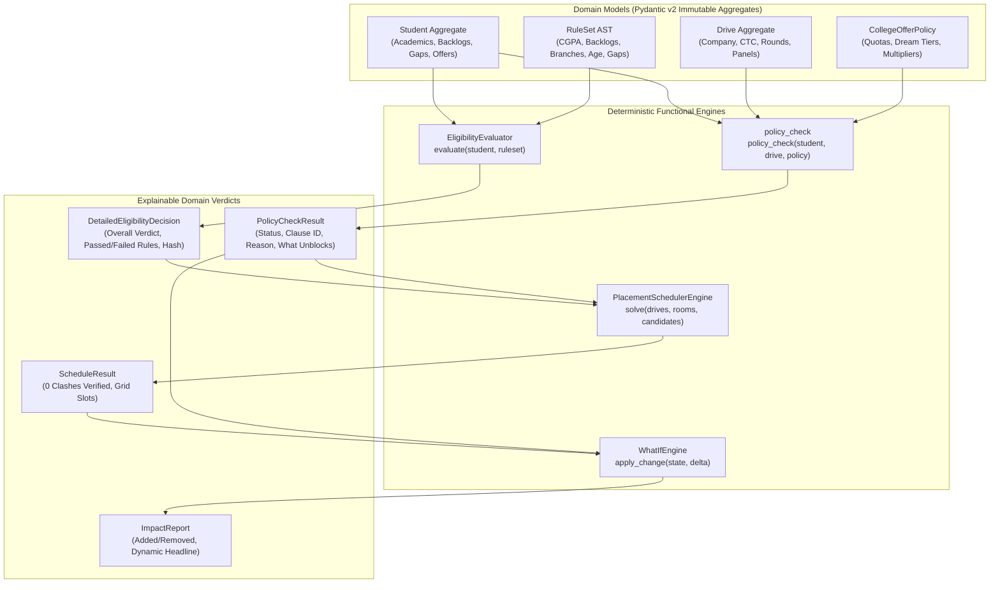
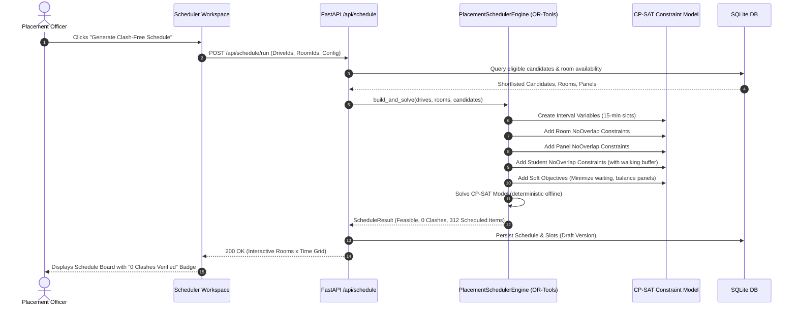
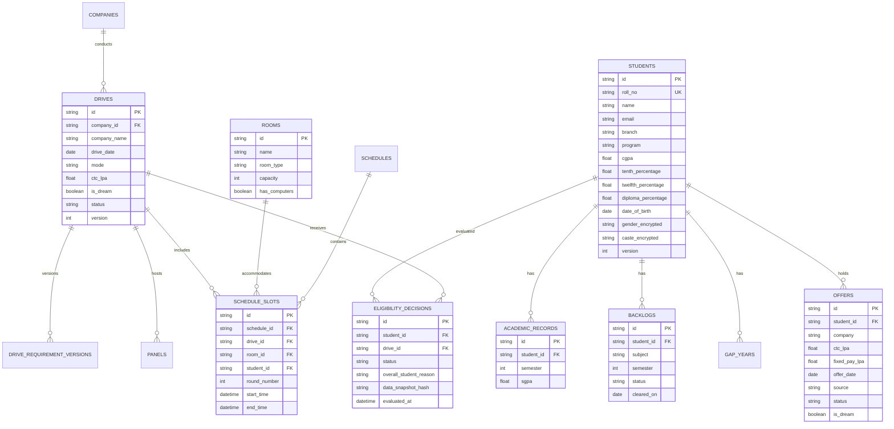

# Institutional Placement Engine Architecture (Core Engine)

## Executive Summary

The Institutional Placement Engine is an air-gapped, zero-cloud system engineered to coordinate high-volume collegiate placement seasons. It provides deterministic academic eligibility evaluation, live institutional offer policy enforcement, NLP requirement extraction from announcement documents, constraint-based clash-free test/interview scheduling, and what-if impact simulation.

---

## 1. C4 Context Diagram



---

## 2. C4 Container Diagram

```mermaid
flowchart LR
    subgraph Client_Tier["Client Tier (Browsers on Campus LAN)"]
        OfficerSPA["Officer Workspace SPA<br>(React 18 + Vite + Tailwind CSS)"]
        StudentSPA["Student Mobile Portal<br>(Responsive Single-Page App)"]
    end

    subgraph Application_Tier["Local Application Server (Port 8000)"]
        StaticServer["Static File Server<br>(Serves SPA App-Shell from /dist)"]
        AuthMiddleware["Argon2id Auth & Session Guard<br>(HttpOnly Cookies + CSRF)"]
        APIRouter["FastAPI REST API<br>(Pydantic Input Validation)"]

        subgraph Pure_Domain["Pure Domain Core (No I/O, Pure Logic)"]
            RuleEngine["AST Rule Evaluator<br>(Eligibility Evaluator)"]
            PolicyEngine["Offer Policy Checker<br>(Live Quota & Upgrades)"]
            SchedulerEngine["OR-Tools CP-SAT<br>(Constraint Scheduler)"]
            WhatIfEngine["What-If Impact Engine<br>(In-Memory Delta Engine)"]
            Extractor["Deterministic Extractor<br>(pdfplumber + regex)"]
        end

        RepoLayer["Repository & UoW Layer<br>(SQLAlchemy ORM Decoupled via Protocols)"]
    end

    subgraph Data_Tier["Encrypted Local Storage"]
        SQLiteDB[("SQLite Database<br>(AES-256 Encrypted Columns)")]
        EncBackups[("PBKDF2 Encrypted Backups<br>(.enc Archive)")]
    end

    OfficerSPA -->|"REST over LAN"| AuthMiddleware
    StudentSPA -->|"REST over LAN"| AuthMiddleware
    AuthMiddleware --> APIRouter
    APIRouter --> Pure_Domain
    Pure_Domain <--> RepoLayer
    RepoLayer <--> SQLiteDB
    RepoLayer -.->|"Encrypted Snapshot"| EncBackups
```



---

## 3. Pure-Domain Architectural Blueprint

The system strictly decouples business domain logic from infrastructure dependencies:



---

## 4. Sequence Diagram: What-If Simulation Workflow

Demonstrates how placement officers evaluate proposed cut-off or policy changes with instant in-memory feedback and zero database mutation:

```mermaid
sequenceDiagram
    autonumber
    actor Officer as Placement Officer
    participant UI as What-If Panel (UI)
    participant API as FastAPI /api/what-if
    participant Engine as What-If Domain Engine
    participant AST as Rule Engine & Policy Checker
    participant DB as SQLite DB

    Officer->>UI: Adjusts CGPA cut-off (e.g. 7.0 -> 6.5)
    UI->>API: POST /api/what-if/preview (DriveId, Delta)
    API->>DB: Fetch current Student & Drive state
    DB-->>API: Active Domain Aggregates
    API->>Engine: apply_change(current_state, delta)
    Note over Engine: Pure in-memory simulation (No DB mutation)
    Engine->>AST: Re-evaluate affected candidate pool
    AST-->>Engine: Delta shortlists & offer policy impacts
    Engine->>Engine: Run minimal-disturbance clash check
    Engine->>Engine: Compute data-driven dynamic headline
    Engine-->>API: ImpactReport (Added, Removed, Clashes, Headline)
    API-->>UI: 200 OK (JSON Impact Report)
    UI-->>Officer: Displays "Lowering cut-off adds 38 students; 6 clash with Northwind"
```

---

## 5. Sequence Diagram: Clash-Free Constraint Scheduling

Demonstrates the OR-Tools CP-SAT constraint formulation solving 600 students across 12 drives in ~1 second:



---

## 6. Relational Database Schema (ERD)


